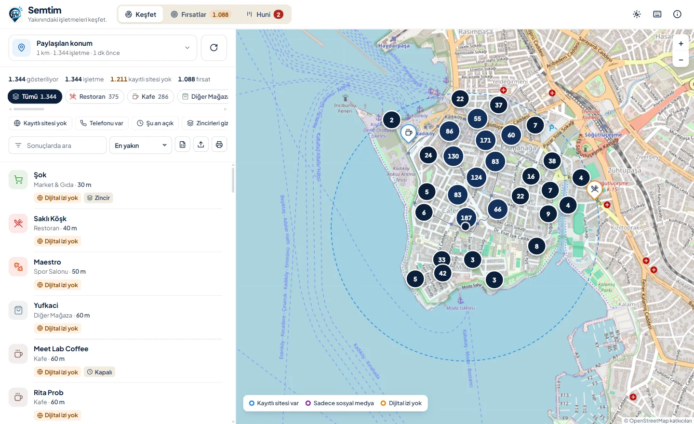
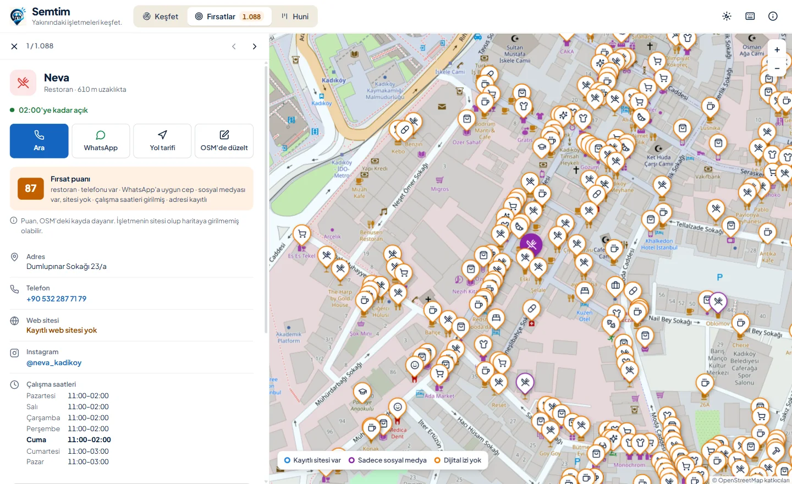
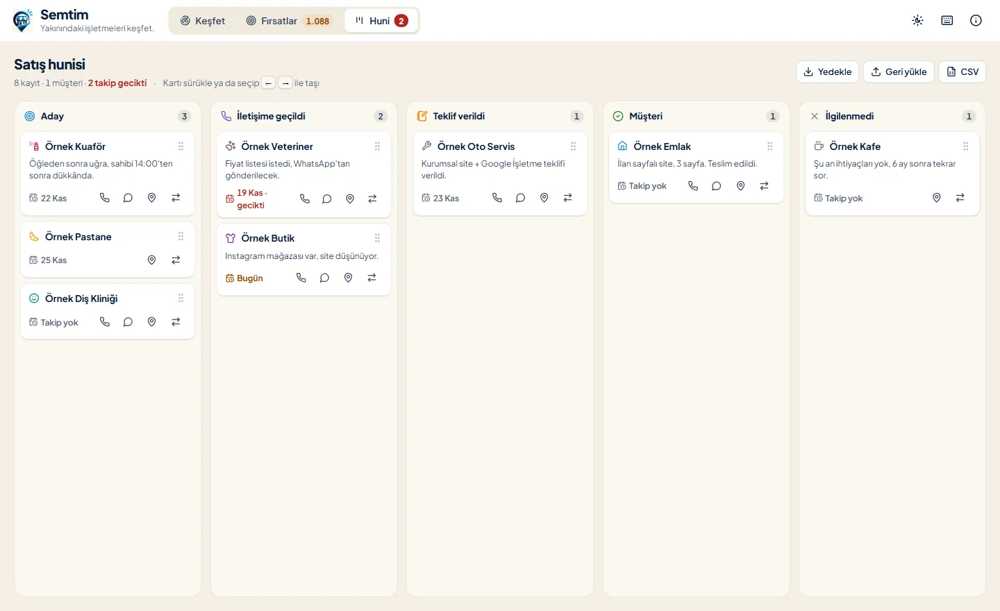
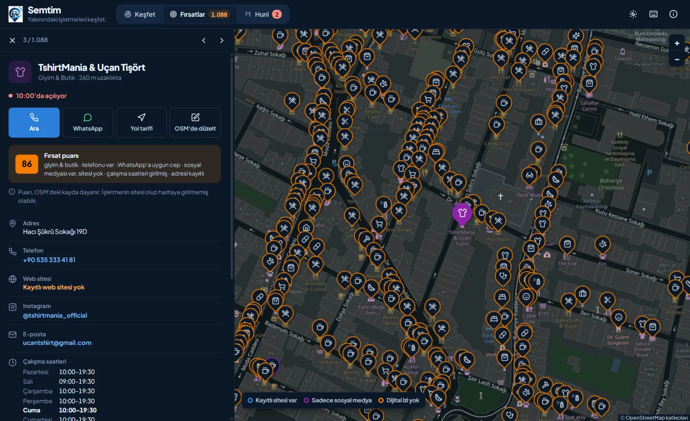
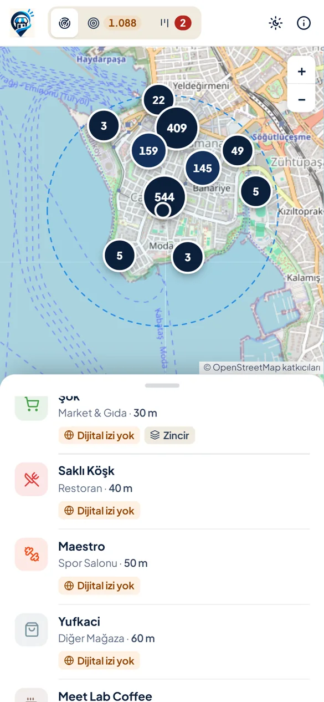
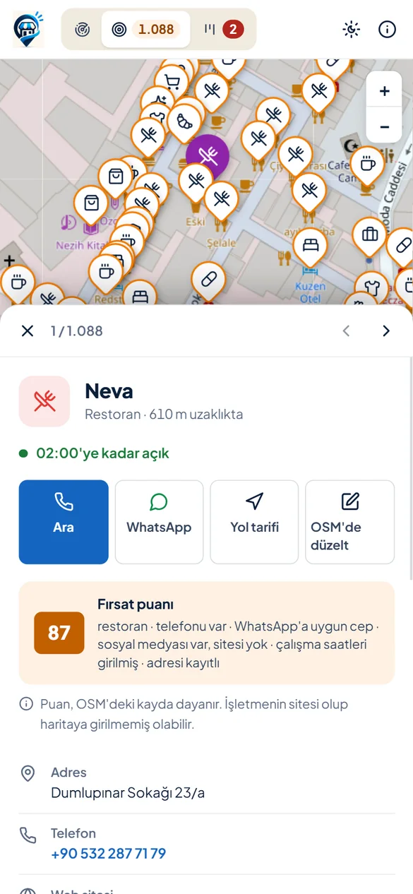
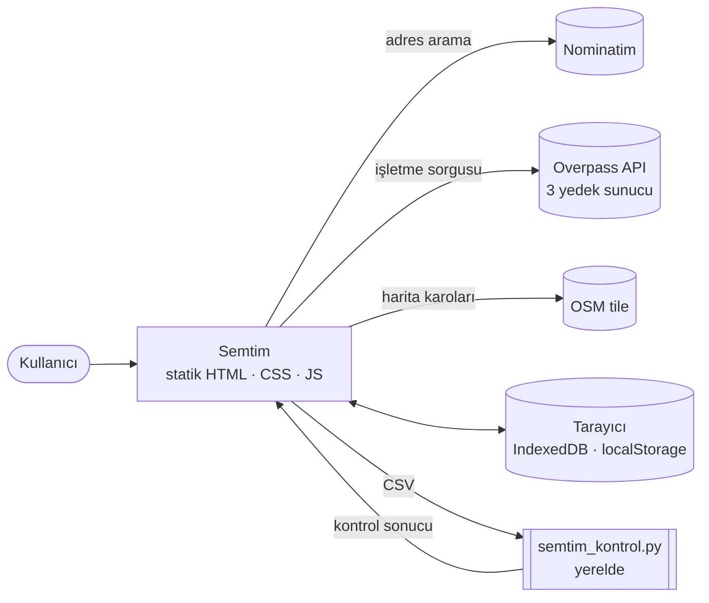

<div align="center">


# Semtim

**Yakınındaki işletmeleri keşfet. Sitesi olmayanları bul, müşteriye çevir.**

Seçtiğin noktanın 10 km çevresindeki işletmeleri OpenStreetMap'ten anlık çeker, kayıtlı web sitesi olmayanları puanlar
ve adaylarını aşama aşama takip etmeni sağlar. Sunucu yok, üyelik yok, ücret yok.

[](https://github.com/ardairmk55/Semtim/actions/workflows/ci.yml)
[](LICENSE)
[](#hızlı-başlangıç)
[](#altyapı)
[](https://www.openstreetmap.org/copyright)

[Özellikler](#özellikler) · [Hızlı başlangıç](#hızlı-başlangıç) · [Yayınlama](#yayınlama) · [Altyapı](#altyapı) · [Gizlilik](#gizlilik-ve-kvkk)

<br>



</div>

<br>

## Neden Semtim?

Web tasarımcısı, ajans ya da sahada çalışan bir satışçıysan, bir semtte **sitesi olmayan işletmeleri** bulmak saatler alır. Semtim bunu dakikalara indirir:

1. **Tara.** Bir semt ara, konumunu kullan ya da haritaya tıkla. 0,5–10 km yarıçaptaki tüm işletmeler gelir.
2. **Önceliklendir.** Fırsatlar sekmesi, kayıtlı sitesi olmayan bağımsız işletmeleri 0–100 puanla sıralar.
3. **Ulaş.** Tek dokunuşla ara, WhatsApp'tan yaz ya da yol tarifi al.
4. **Takip et.** Adayı huniye ekle; not, takip tarihi ve aşamayla müşteriye dönüşene kadar izle.

## Özellikler

<table>
<tr>
<td width="50%" valign="top">

### Fırsatlar ve detay paneli

Her işletmenin açık/kapalı durumu, çalışma saatleri, telefonu, sosyal medyası ve **fırsat puanı** tek panelde. Puanın nedenleri yazılıdır: telefonu var, WhatsApp'a uygun cep, sosyal medyası var ama sitesi yok…

- “Şu an açık” filtresi (OSM `opening_hours` ayrıştırıcı)
- Sektör çipleri, zincir gizleme, metin arama
- CSV dışa aktarma ve yazdırılabilir ziyaret listesi

</td>
<td width="50%" valign="top">



</td>
</tr>
<tr>
<td width="50%" valign="top">



</td>
<td width="50%" valign="top">

### Satış hunisi

Aday → İletişime geçildi → Teklif verildi → Müşteri / İlgilenmedi.

- Kartları **fareyle ya da parmakla** sürükle-bırak (telefonda basılı tut)
- Klavyeyle taşı (`←` `→`), her taşımada **Geri al**
- Takip tarihi geçen kayıtlar kırmızı, üst barda sayaç
- JSON yedek / geri yükleme ve CSV

<sub>Görseldeki işletme adları örnektir.</sub>

</td>
</tr>
<tr>
<td width="50%" valign="top">

### Site sağlık kontrolü

Sitesi olan işletmeler için bilgisayarında küçük bir Python aracı çalıştır: site açılıyor mu, HTTPS ve geçerli SSL var mı, mobil uyumlu mu, ne kadar hızlı? Çıkan dosyayı Semtim'e geri yükle; kartlarda **0–100 site skoru**, “Zayıf site” filtresi ve “Zayıf site önce” sıralaması belirir.

### Açık ve koyu tema

Sistem temasını izler ya da elle seçilir. Koyu temada harita da kararır.

</td>
<td width="50%" valign="top">



</td>
</tr>
</table>

### Mobilde

<table>
<tr>
<td width="34%" valign="top"></td>
<td width="34%" valign="top"></td>
<td valign="top">

Telefonda harita tam ekran, liste alttan çekilen bir sayfadır: tutamaktan sürükleyerek **küçük / orta / büyük** yap. Bir işletmeye dokununca harita, işareti görünen alana ortalar.

Ana ekrana eklenebilir (PWA) ve son taramalar **çevrimdışı** da açılır.

</td>
</tr>
</table>

### Klavye kısayolları

| Tuş | İş | Tuş | İş |
|:---:|---|:---:|---|
| `/` | Adres aramaya odaklan | `H` | Seçili işletmeyi huniye ekle |
| `T` | Bu çevreyi tara | `P` | Ziyaret listesini yazdır |
| `1` `2` `3` | Keşfet · Fırsatlar · Huni | `Esc` | Ayrıntıyı kapat |
| `J` `K` | Sonraki / önceki işletme | `?` | Kısayol listesi |

## Hızlı başlangıç

Derleme (build), `npm install` ya da veritabanı **gerekmez**. Küçük bir yerel sunucu yeter:

```bash
git clone https://github.com/ardairmk55/Semtim.git
```

```bash
cd Semtim
```

```bash
python -m http.server 8000
```

Tarayıcıda **http://localhost:8000** adresini aç. Konum izni ve service worker `file://` adresinde çalışmaz; bu yüzden çift tıklamak yerine sunucu kullan.

> Yerelde service worker kapalıdır, böylece düzenlediğin dosyalar önbellekten gelmez. PWA'yı yerelde denemek için adrese `?sw=1` ekle.

## Yayınlama

### GitHub + Vercel (önerilen)

1. [vercel.com/new](https://vercel.com/new) → **Import Git Repository** → bu depoyu seç.
2. **Framework Preset: Other**. Build Command ve Output Directory boş kalsın. **Deploy**.

Bundan sonra `main`'e her push otomatik yayınlanır. [`vercel.json`](vercel.json) güvenlik başlıklarını (HSTS, X-Frame-Options, Permissions-Policy…) ekler; [`.vercelignore`](.vercelignore) testleri ve geliştirme dosyalarını yayından çıkarır.

### Başka bir yer

Klasörü herhangi bir statik sunucuya kopyalaman yeterli: Netlify, Cloudflare Pages, GitHub Pages, kendi sunucun ya da bir alt klasör (`ornek.com/semtim/`). Tüm yollar görelidir; konum izni ve PWA için HTTPS gerekir.

> **Yeni sürüm yayınlarken** [`sw.js`](sw.js) içindeki `SURUM` değerini artır; kullanıcıların tarayıcısındaki eski önbellek böylece yenilenir.

## Altyapı



| Konu | Çözüm |
|---|---|
| Bağımlılıklar | Leaflet, markercluster ve yazı tipi `vendor/` ve `fonts/` altında. Sayfa hiçbir CDN'e bağlı değil. |
| Güvenlik | Content-Security-Policy yalnızca kendi dosyalarına ve OSM servislerine izin verir. OSM'den gelen her metin kaçışlı basılır, yalnızca http(s) bağlantılarına izin verilir, CSV formül enjeksiyonuna karşı korunur, içe aktarılan dosyalar alan alan doğrulanır. |
| İşletme verisi | Overpass API. Her sunucuya süre sınırı tanınır; yanıt yoksa ya da hata verirse sıradaki yedeğe geçilir ve son çalışan sunucu bir sonraki sorguda önce denenir. |
| Büyük alanlar | 4 km'den büyük taramalar 4 ya da 9 parçaya bölünür; zaman aşımını önler, ilerleme gösterir. |
| Önbellek | Sonuçlar 7 gün IndexedDB'de. Aynı noktadaki büyük tarama küçük yarıçaplar için yeniden kullanılır; sunucular çökükse eski önbellek uyarıyla gösterilir. |
| Çevrimdışı | Service worker uygulama kabuğunu ve son 600 harita karosunu saklar. |
| Adres arama | Nominatim: saniyede en fazla 1 istek, otomatik tamamlama yok, sonuçlar 30 gün önbellekte. |
| “Şu an açık mı?” | [`js/saatler.js`](js/saatler.js) OSM `opening_hours` biçiminin yaygın alt kümesini okur (gün aralıkları, öğle arası, gece yarısını aşan saatler, `24/7`, `off`). Emin olamadığı ifadede tahmin yürütmez. |
| İkonlar | [Lucide](https://lucide.dev) (ISC). Kullanılan ikonlar tek bir SVG sprite'ta; emoji kullanılmaz. |

<details>
<summary><b>Klasör yapısı</b></summary>

```
Semtim/
├── index.html              # arayüz
├── manifest.webmanifest    # PWA tanımı
├── sw.js                   # service worker: kabuk ve harita karosu önbelleği
├── vercel.json             # Vercel: güvenlik başlıkları, önbellek süreleri
├── css/semtim.css          # tasarım sistemi (açık/koyu tema tokenları, tüm bileşenler)
├── js/
│   ├── tema-erken.js       # temayı ilk boyamadan önce uygular
│   ├── ikonlar.js          # Lucide ikon sprite'ı (otomatik üretilir)
│   ├── turkce.js           # telefon, saat, mesafe, güvenli HTML yardımcıları
│   ├── sektor.js           # OSM etiketi → Türkçe sektör + ikon, Overpass filtreleri
│   ├── saatler.js          # opening_hours ayrıştırıcı: "şu an açık mı?"
│   ├── huni.js             # satış hunisi: aşama, not, takip tarihi, JSON yedek
│   ├── surukle.js          # fare + dokunmatik sürükle-bırak
│   ├── site-kontrol.js     # site sağlık kontrolü CSV'sini içe aktarır
│   ├── veri.js             # Nominatim, Overpass, önbellek, fırsat puanı
│   └── app.js              # harita, liste, detay, huni panosu, kısayollar
├── fonts/  vendor/  img/   # yerel yazı tipi, kütüphaneler, görseller
├── tests/                  # node:test birim testleri (bağımlılık yok)
├── araclar/
│   ├── semtim_kontrol.py   # web sitesi sağlık kontrolü (Python)
│   ├── yayin-kontrol.mjs   # yayın öncesi kontrol (npm run kontrol)
│   └── ikonlari-uret.mjs   # ikon sprite'ını yeniden üretir
└── docs/                   # README ekran görüntüleri
```

</details>

<details>
<summary><b>Fırsat puanı nasıl hesaplanır?</b></summary>

Puan 0 ile 100 arasındadır ve yalnızca kayıtlı sitesi olmayan, zincir olmayan işletmelere verilir. Hesaba katılanlar: sektörün site alma eğilimi (diş kliniği, güzellik, kuaför yüksek; market ve eczane düşük), telefon, WhatsApp'a uygun cep numarası, sosyal medya hesabı, çalışma saatleri ve adres. Puan kesin bir tahmin değildir, bir öncelik sırası verir.

**“Kayıtlı sitesi yok” ne demek?** İşletmenin OpenStreetMap kaydında site bilgisi girilmemiş demek; gerçekte sitesi olabilir. Eksik bilgiyi her işletmenin **OSM'de düzelt** bağlantısından herkes ekleyebilir.

</details>

<details>
<summary><b>Web sitesi sağlık kontrolü (Python)</b></summary>

Tarayıcı güvenlik nedeniyle başka sitelerin içeriğini okuyamaz; bu kontrol bilgisayarında çalışan küçük bir araçla yapılır. Kurulum gerektirmez (Python 3.9+).

```bash
python3 araclar/semtim_kontrol.py semtim-kadikoy-kesif-2026-11-19.csv
```

```bash
python3 araclar/semtim_kontrol.py --url kahveduragi.com --url ornek.com.tr
```

Çıktı, aynı CSV'nin sonuna `site_durumu`, `https`, `ssl_gecerli`, `mobil_uyumlu`, `yukleme_ms`, `baslik`, `dijital_skor` ve `notlar` sütunlarını ekler. Bu `*-kontrol.csv` dosyasını Semtim'deki yükleme düğmesiyle geri yükle.

| Dijital skor | Puan |
|---|---:|
| Site açılıyor | 40 |
| HTTPS + geçerli SSL | 20 |
| Mobil uyumlu (viewport) | 20 |
| 3 saniyenin altında yükleniyor | 10 |
| Sayfa başlığı var | 10 |

Skoru 60'ın altında kalan siteler yenileme teklifi için iyi adaylardır.

</details>

<details>
<summary><b>Testler ve yayın kontrolü</b></summary>

Node 20+ yeterli, `npm install` gerekmez:

```bash
npm test
```

```bash
npm run kontrol
```

`npm test` saat ayrıştırıcıyı, huniyi, site kontrol içe aktarmayı, Overpass yedek sunucu geçişini, veri dönüştürmeyi ve ikon eşlemesini test eder. `npm run kontrol` her dosyanın var olduğunu, mutlak yol ya da CDN kullanılmadığını ve arayüzde emoji olmadığını doğrular. İkisi de her push'ta [GitHub Actions](.github/workflows/ci.yml) ile çalışır.

**İkon eklemek için** `araclar/ikonlari-uret.mjs` içindeki listeye Lucide adını ekle, sonra:

```bash
npm i --no-save lucide-static@0.460.0
```

```bash
node araclar/ikonlari-uret.mjs node_modules/lucide-static/icons
```

</details>

## Gizlilik ve KVKK

Semtim'in **kendi sunucusu ve veritabanı yoktur**. Hesap açtırmaz, çerez ve takip aracı kullanmaz. Huni, notlar ve tercihler yalnızca kullanıcının tarayıcısında durur; uygulamadaki **Hakkında → Gizlilik ve KVKK bilgilendirmesi** penceresi ayrıntıları anlatır ve bu cihazdaki tüm verileri tek düğmeyle siler.

İşletme bilgileri OpenStreetMap'teki açık verilerdir. Şahıs işletmelerinde telefon ve e-posta kişisel veri sayılabilir: bu bilgileri meşru amaçla kullan, toplu SMS / e-posta göndereceksen 6563 sayılı Kanun ve İYS kurallarına, 6698 sayılı KVKK'ya uy.

## Kurallar ve atıf

- Harita ve veri: © [OpenStreetMap katkıcıları](https://www.openstreetmap.org/copyright), ODbL lisansı. Atıf haritada görünür kalmalı.
- Nominatim ve Overpass ücretsiz, gönüllü servislerdir: önbelleği kapatma, otomatik tamamlama ekleme, toplu/otomatik sorgu atma.
- Harita karoları `tile.openstreetmap.org`'dan gelir; trafik çok artarsa başka bir karo kaynağına geçilmeli.
- Üçüncü taraf lisansları: Leaflet (BSD-2), Leaflet.markercluster (MIT), Lucide (ISC), Plus Jakarta Sans (OFL). Metinleri `vendor/` ve `fonts/` altında.

## Lisans

[MIT](LICENSE) © 2026 Arda Irmak

<div align="center">
<br>

Tasarım ve geliştirme: **[Arda Irmak](https://ardaportfoy.vercel.app/)**

</div>
